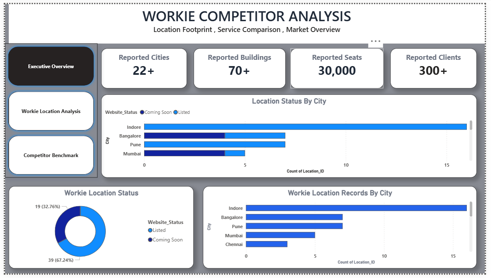
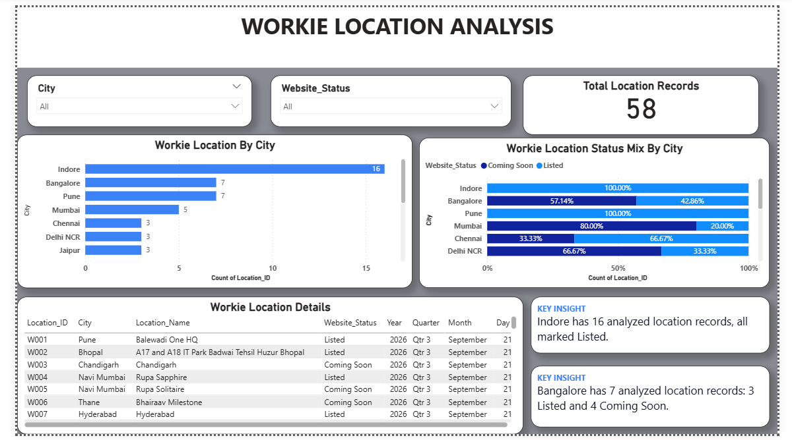
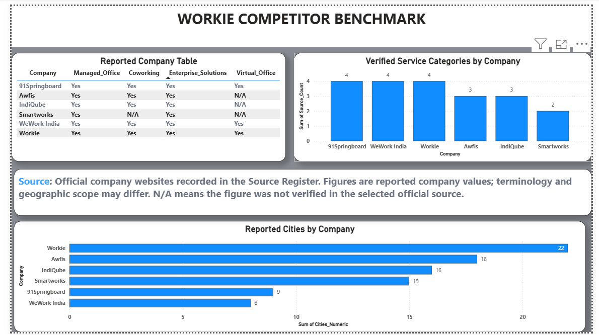

# Workie Competitor Analysis

## Project Overview

This project presents a competitor analysis of Workie in the coworking and managed office space industry.

The analysis compares Workie with selected competitors using publicly available information verified from official company sources.

## Companies Covered

* Workie
* Awfis
* WeWork India
* Smartworks

## Key Analysis Areas

* Cities / Geographic Presence
* Centres / Locations
* Seats / Desks
* Clients / Members
* Service Offerings
* Competitor Benchmarking

## Tools Used

* Microsoft Excel
* Power BI
* CSV
* Data Validation & Analysis

## Data Sources

Data points were manually verified from official company websites and recorded in structured Excel/CSV files.

Each dataset was reviewed for consistency and source traceability before being used for analysis and visualization.

## Project Files

* `Workie_City_Summary_Final.csv` — Workie location and city-level summary
* `Workie_Competitor_Benchmark_Final.csv` — Competitor comparison dataset
* `workie competitor analysis.pbix` — Power BI report

## Important Data Note

Company figures such as cities, centres, seats, clients, and members may change over time. Therefore, the analysis reflects the information available and verified at the respective verification dates.

For Workie, source-specific figures were retained where different official Workie pages provided different numbers.

## Objective

The objective of this project is to organize publicly available competitor information into a structured dataset and present it through Power BI to support business comparison and reporting.
## Dashboard Preview

### Workie Dashboard Overview

### Competitor Analysis

### City Analysis

